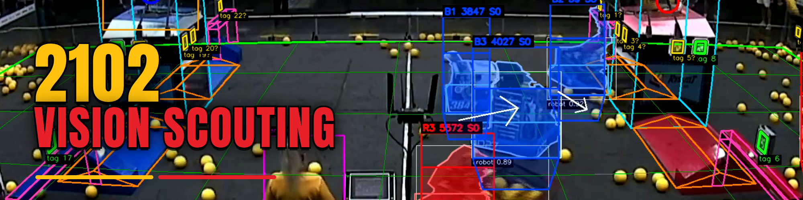
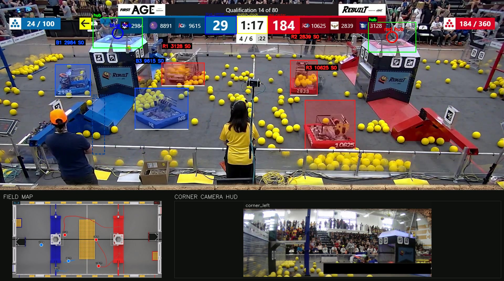
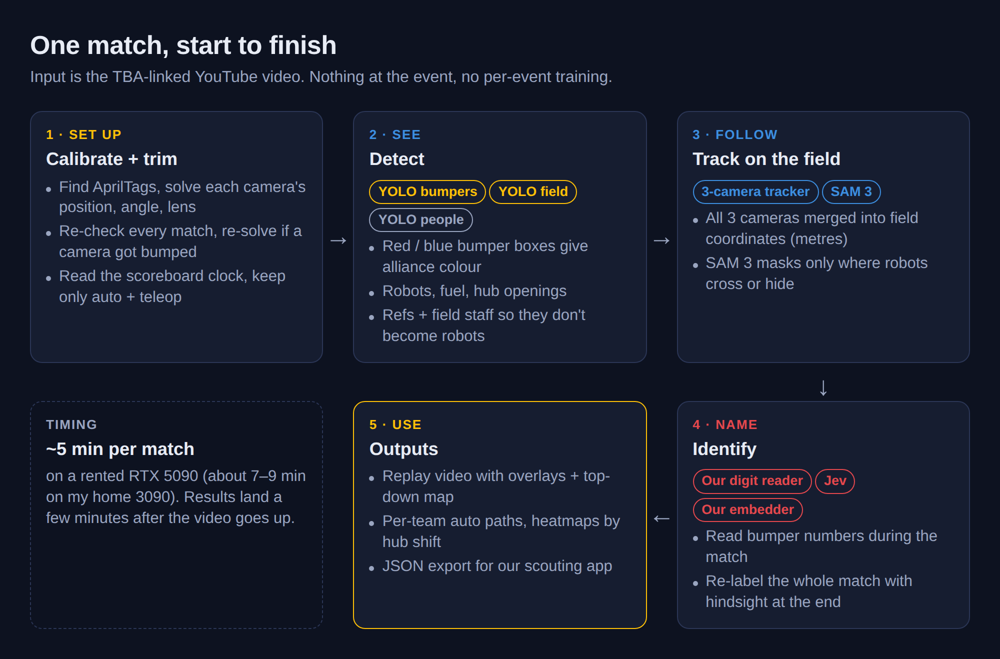
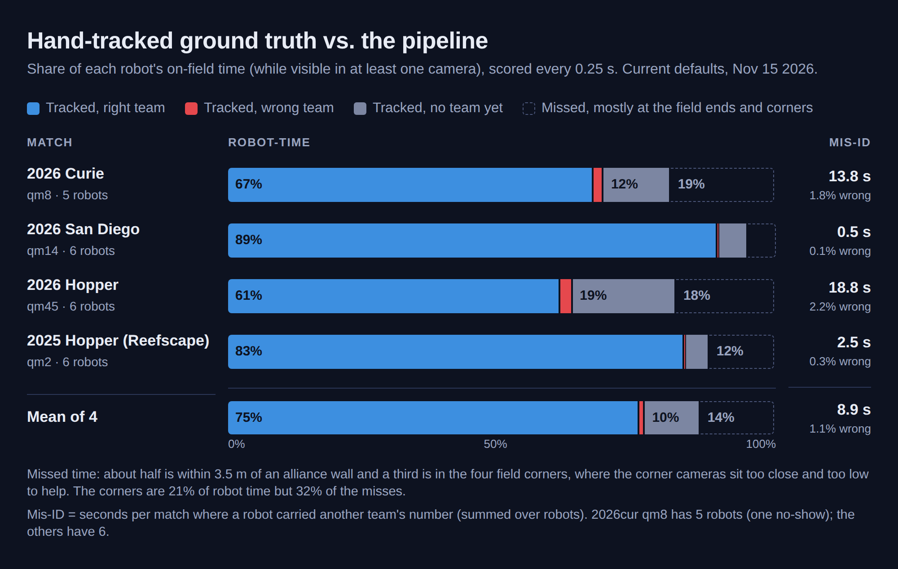
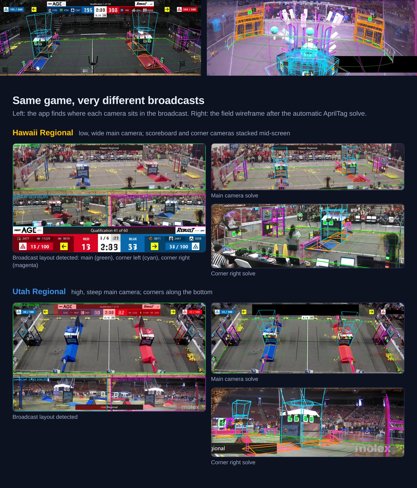
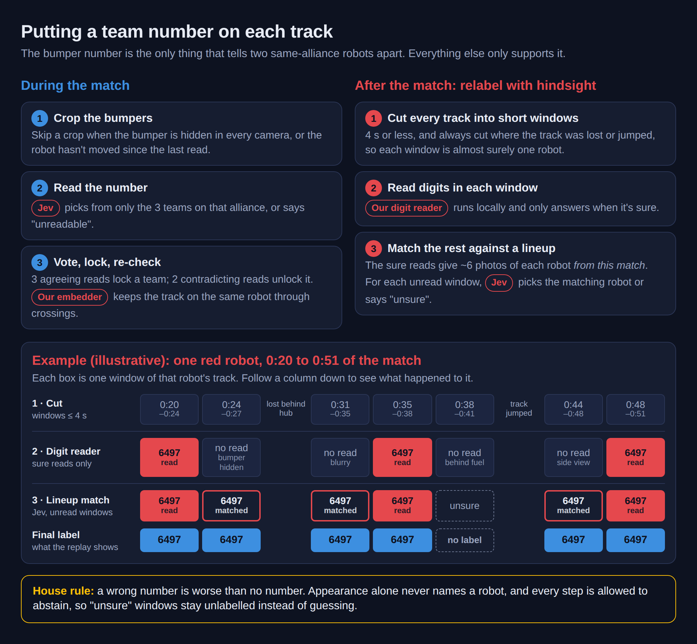
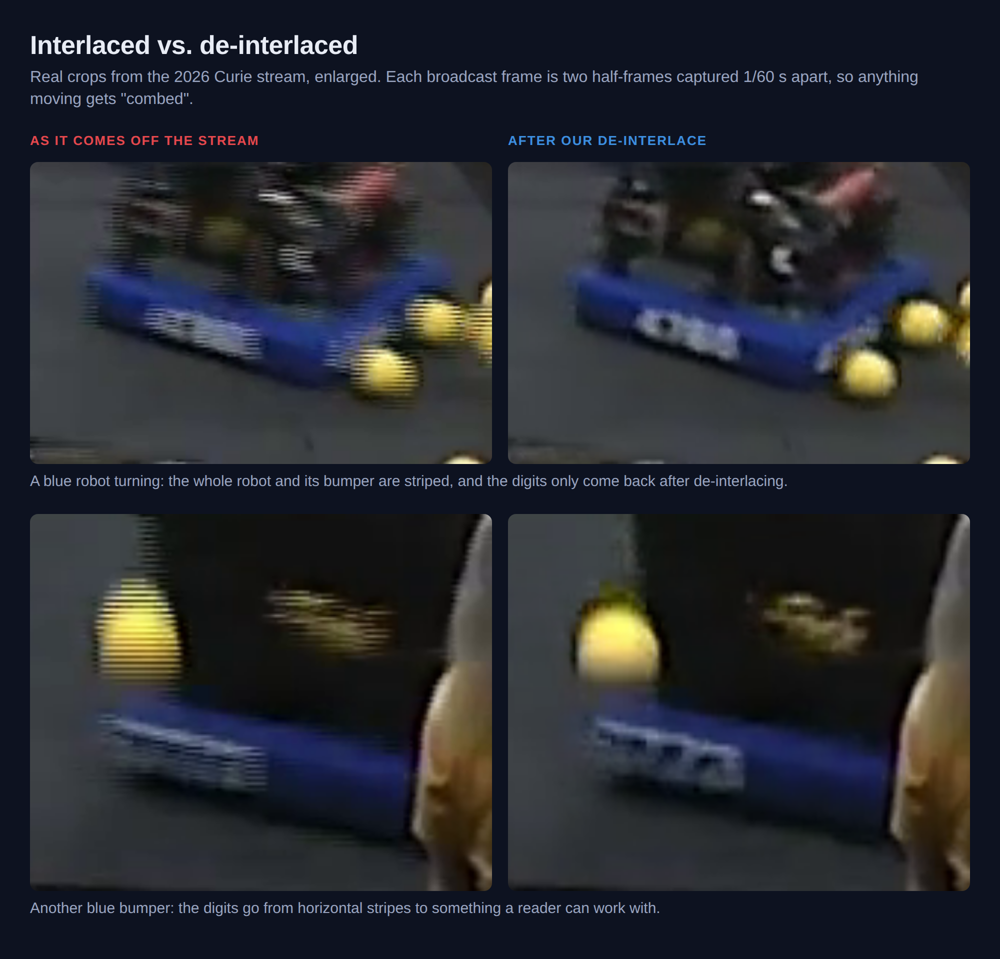
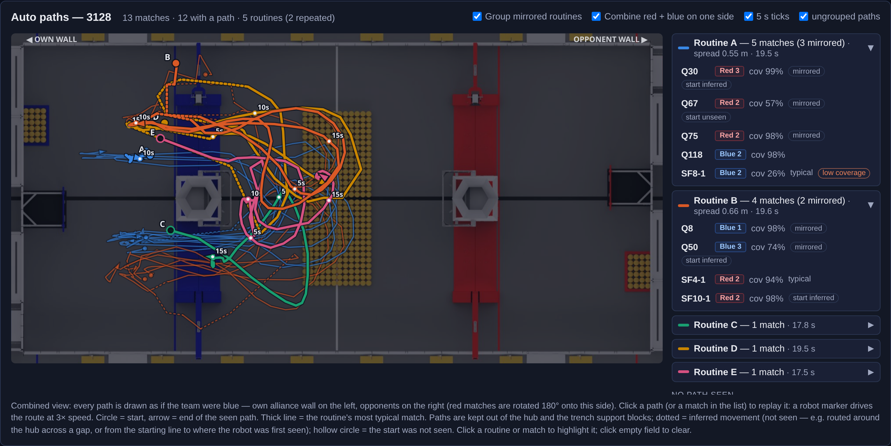
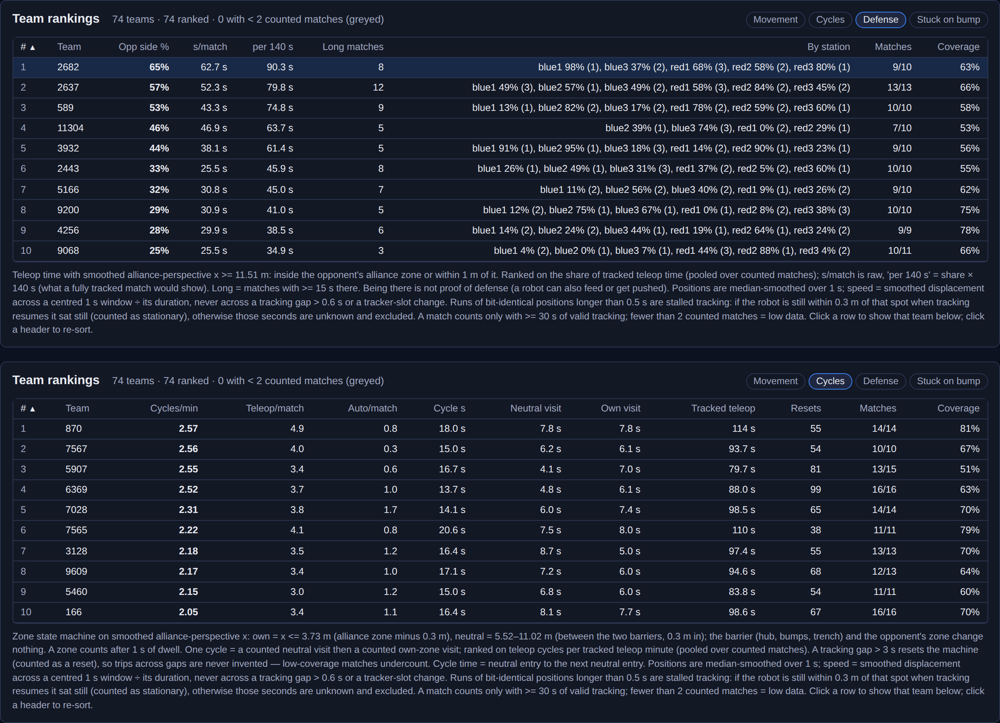
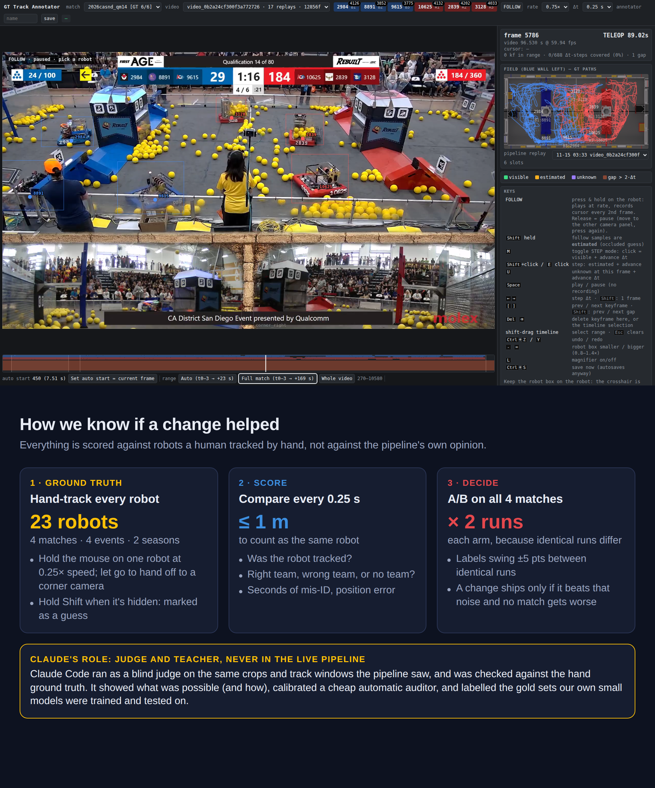

# FRC Vision Scorer

Automated vision scouting for FRC from the event livestream. Point it at an
event on The Blue Alliance and it tracks every robot on the field in meters,
puts a team number on each one by reading bumpers, and turns that into
scouting data: auto paths, heatmaps, cycle counts, defense time and more. No
human scouters, no cameras or equipment at the event, and no per-event
training.

Built by FRC Team 2102 (Team Paradox) during the 2026 REBUILT season. It's a
work in progress: detection, location and identity work well; per-robot
scoring doesn't exist yet.

- **Demo reel** (20 minutes of the whole 2026 Curie Division, good, middling
  and bad): https://youtu.be/ZpAQoMeAiNk
- **Full write-up** with every chart and how it was tested:
  [docs/blog/vision-scouting.md](docs/blog/vision-scouting.md)



## Contents

- [What It Does](#what-it-does)
- [Results So Far](#results-so-far)
- [How It Works](#how-it-works)
- [How It's Tested](#how-its-tested)
- [Limitations](#limitations)
- [Hardware](#hardware)
- [Install](#install)
- [Model Weights](#model-weights)
- [Running Locally](#running-locally)
- [Running in the Cloud](#running-in-the-cloud)
- [Configuration](#configuration)
- [Project Structure](#project-structure)
- [Tests](#tests)
- [Acknowledgements](#acknowledgements)
- [License](#license)

## What It Does



1. **Set up.** Work out where each broadcast camera is and how its lens bends
   the image, using the AprilTags on the field. Read the scoreboard clock so
   only auto and teleop get processed.
2. **See.** YOLO detectors find bumpers (and their alliance color), robots,
   fuel, hub openings and people.
3. **Follow.** All three camera views (the main camera and two corner
   cameras) are projected onto the field in meters and merged into one
   tracker, so a robot is a point on the field, not a box in a video.
4. **Name.** Bumper numbers are read to put a team on each track, then the
   whole match is relabelled with hindsight once it's over.
5. **Use.** A replay video with overlays and a top-down map, per-team auto
   paths and heatmaps, event-wide rankings, and a JSON export.

A full match takes about 5 minutes on a rented RTX 5090, or 7-9 minutes on a
home RTX 3090.

## Results So Far

**Hand-tracked ground truth.** On 4 matches from 4 events across 2 seasons,
tracked by hand robot by robot, the pipeline tracks 86% of robot time and has
the right team number on 75% of it. It has the wrong team number about 1% of
the time; the rest is "tracked, but not confident enough to name yet", which
is deliberate.



**A whole event.** The entire 2026 Curie Division (138 matches) ran unattended
straight from the TBA videos:

- 137 of 138 matches processed in 16.7 hours on one RTX 3090 (median 7.5
  minutes a match), with about $8 of Jev reads for the whole event.
- 86% of robot time tracked and 79% of that named, in line with the
  hand-tracked numbers. About 1% of named time has the wrong team, estimated
  by an automatic auditor that checked about 4,400 sampled moments.
- The main camera moved twice during the event; both times the match noticed,
  re-solved its calibration from its own frames and carried on.

**Against human scouting.** The event-wide rankings were checked against
3128's human-scouted Manta data and Match13's team ratings. Auto cycles and
defense time line up with the scouts at about 0.8 (Spearman); speed is
looser, and stuck-on-the-bump is the weakest. It's good for sorting teams
into tiers, not for deciding whether a team is 12th or 15th. Details and
charts are in the [write-up](docs/blog/vision-scouting.md).

## How It Works

### Camera calibration: AprilTags + field geometry

The broadcast cameras are the same at every event, but their angles aren't,
and they get bumped mid-event. Calibration solves each camera's position,
angle and lens distortion from the AprilTags and the known field layout. Most
tags are too small on the stream to decode, so the app finds tag-shaped
squares, has Jev confirm each one is a tag, and uses the field map to work out
which tag it must be. It runs automatically when an event is loaded; you
review the overlay at `/calibrate` and confirm it, or correct it by hand.

The lenses are wide-angle with strong fisheye warp at the edges, so the solve
needs tags from the middle *and* the far edges of each view; otherwise the
overlay looks right in the middle and robots near the edges land in the wrong
place. Every match is checked against the calibration: if a camera moved
between matches it re-solves from that match, and if one moves *during* a
match that camera is dropped for the match rather than producing garbage
positions. The broadcast layout (where the main and corner cameras sit in the
stream) is detected too, since it varies a lot between events.



Field geometry also lets the tracker ignore anything outside the field
(robots in queue, the stands) and refuse to start a new robot on static
structures such as hubs and FMS radio poles.

### Detection: YOLO

- **Bumper model** (trained by us): red and blue bumpers, which also gives the
  alliance color, with hard negatives for field equipment that kept getting
  detected as robots.
- **Field model** (trained by us): robots, fuel and hub openings.
- **Stock YOLO person model**, so refs and field staff don't become robots.

On top of the models are sanity checks added one false positive at a time:
boxes that overlap a person, or that are implausibly wide for their distance
from the camera, are rejected.

### Tracking: multi-camera field tracker + SAM 3

The tracker turns per-frame detections into six robots moving around the
field, merging all three cameras in field coordinates. When a robot goes
somewhere no camera can see, it coasts instead of becoming a "new" robot when
it reappears. **SAM 3** (Meta's Segment Anything 3) masks and follows whole
robots, but only runs where it's needed: when robots get close, cross, or
disappear behind something. Running SAM 3 on every robot every frame was
tried and was both slower and worse on the ground truth, as were higher
frame rates.

### Identity: reading bumper numbers

The bumper number is the only thing that reliably tells two robots on the
same alliance apart, so everything else only supports it.



- **Jev**, a hosted "decision model" from TypeSafe: given an image and a
  multiple-choice question ("which of these 3 teams is this, or is it
  unreadable?") it returns a probability per answer. About 0.2 s and a
  fraction of a cent per read, and it can't invent a team that isn't an
  option.
- **Our digit reader** (PARSeq, fine-tuned on about 54,000 bumper crops from 15
  events across 2024-2026). On events it never saw, it gets about 92% of
  readable bumpers right and is wrong on under 0.5%; otherwise it declines.
- **Our robot embedder** (DINOv3, fine-tuned on pairs of the same robot from
  different matches). It keeps tracks on the same robot through crossings; it
  is never allowed to name a robot by itself.

During the match, a team locks after 3 agreeing reads and unlocks after 2
contradicting ones; a confidently wrong lock is much worse than an
unconfident one. After the match, the **hindsight relabel** cuts every track
into short windows, reads digits in each, builds a "lineup card" of each
robot *from this match* out of the sure reads, and has Jev match the
remaining windows against it. Anything still unsure stays unlabelled.

Many event streams are **interlaced** (each frame is two half-frames 1/60 s
apart), which combs moving bumpers into stripes. The relabel de-interlaces
its crops first.



### Training our own models: teacher and students

The digit reader and embedder were trained by downloading qual videos from 15
events across 3 seasons, saving about 455,000 bumper and robot crops, having
Jev label them in bulk (about $8 total), having Claude judge a few hundred as
a gold test set, and training small fast models that are only tested on
events they never saw. Claude is a judge and teacher here; it is not part of
the runtime pipeline.

### Scouting output

Once robots have positions and team numbers, `/scouting` shows per-team auto
paths (repeated routines grouped, red-side matches rotated onto the same
side), heatmaps of where a team spends each hub shift split by driver
station, and event-wide rankings for movement, cycles, defense and getting
stuck on the bump. Everything exports as JSON.





## How It's Tested

Changes are judged against **hand-tracked ground truth**, not the pipeline's
own opinion. The annotator (`scripts/gt_annotator_server.py`) lets you follow
one robot at quarter speed with the mouse; a scorer
(`scripts/score_ground_truth.py`) compares every pipeline run to the hand
tracks every 0.25 s. Identical runs differ by a few points, so every change
runs twice on all 4 ground-truth matches and only becomes a default if it
beats that noise and no match gets worse.



## Limitations

- Ground truth is 4 matches: enough to catch regressions, not to promise how
  it does at your event.
- Some matches are just harder. Camera height and angle matter a lot: a
  high, steep camera gives better positions but makes bumpers nearly
  unreadable.
- About a fifth of bumper fonts are too thin or tightly spaced to read at
  broadcast resolution, and low bumpers are easily hidden.
- Corner cameras sit too close and too low to cover the field ends well, and
  the event banner covers part of their view.
- Run-to-run noise is a few points. Fine for trends, not for exact seconds.
- No per-robot scoring. Detection, location and identity carry over to every
  game; scoring will be built for the 2027 game once it's revealed.

## Hardware

| | |
|---|---|
| GPU | NVIDIA with 24 GB VRAM recommended (RTX 3090/4090/5090 class). Peak use is about 13 GB with the defaults. CUDA 12.8 builds: Ampere, Ada, Hopper and Blackwell all work. |
| CPU | The pipeline is mostly serial Python and uses about 3-4 cores per match, so a fast single-thread CPU matters as much as the GPU. |
| RAM | 32 GB or more. |
| Disk | About 20 GB for the environment and model caches, plus about 120 MB per match video. |
| OS | Linux x86_64 (developed on Ubuntu-based Pop!_OS). |

## Install

### 1. System packages

```bash
sudo apt install git git-lfs ffmpeg tesseract-ocr tesseract-ocr-eng libgl1 libglib2.0-0 curl unzip
git lfs install
curl -LsSf https://astral.sh/uv/install.sh | sh    # Python package manager
curl -fsSL https://deno.land/install.sh | sh        # JavaScript runtime yt-dlp needs for YouTube
```

You also need an NVIDIA driver that supports CUDA 12.8.

### 2. Clone

```bash
git clone https://github.com/Paradox2102/frc-vision-scorer.git
cd frc-vision-scorer
ls -lh runs/train/*/weights/best.pt data/teacher/models/*.pt   # 20-52 MB each, not 1 KB pointers
git lfs pull                                                   # only if they're tiny
```

### 3. Python environment

This is the same pinned recipe the cloud bootstrap uses
(`deploy/runpod/bootstrap.sh`):

```bash
uv venv --python 3.12 .venv
uv pip install --python .venv/bin/python --index-strategy unsafe-best-match \
  --override deploy/runpod/requirements-runpod-overrides.txt -r deploy/runpod/requirements-runpod.txt
uv pip uninstall --python .venv/bin/python opencv-python
uv pip install --python .venv/bin/python --reinstall --no-deps opencv-python-headless==4.10.0.84
SAM2_BUILD_CUDA=0 uv pip install --python .venv/bin/python --no-deps --no-build-isolation \
  -r deploy/runpod/requirements-runpod-git.txt
```

### 4. API keys

```bash
cp .env.example .env
```

Then fill in:

| Key | Needed for |
|---|---|
| `TBA_API_KEY` | Required. Event schedules, rosters and match videos. Get a read key at https://www.thebluealliance.com/account. |
| `HF_TOKEN` | Required. SAM 3's weights are gated: request access to [`facebook/sam3`](https://huggingface.co/facebook/sam3) on Hugging Face, then create a read token. Without it, tracking falls back to a plain Kalman tracker. |
| `JEV_TYPESAFE_API_TOKEN` | Required for team numbers. Jev does the live bumper reads, the lineup matching and the tag checks during calibration. Without it, jobs run but robots stay unnamed. |
| `RUNPOD_API`, `VASTAI_API` | Only for renting cloud GPUs. They stay on your machine and are never copied to a server. |

The app loads `.env` itself; there's no need to export it.

## Model Weights

Every model we trained ships in the repo through Git LFS, so `git lfs pull`
gets all of them. Third-party models download themselves on first use.

| Model | Path or source |
|---|---|
| Field model, 2026cur (robots, fuel, hub openings) | `runs/train/hub_zone_yolo26s_2026cur_v2/weights/best.pt` |
| Field model, original (fallback) | `runs/train/hub_zone_yolo26s/weights/best.pt` |
| Bumper detector (with equipment hard negatives) | `runs/train/frc_bumpers_equipment_hardneg/weights/best.pt` |
| Bumper detector, 2026cur (used by the digit reader) | `runs/train/frc_bumpers_2026cur_v3/weights/best.pt` |
| Bumper detector, original (fallback) | `runs/train/frc_bumpers/weights/best.pt` |
| Our digit reader | `data/teacher/models/s1_digits.pt` |
| Our robot embedder | `data/teacher/models/s4_embedder.pt` |
| Person detector (downloaded) | `yolo26n.pt`, from Ultralytics |
| SAM 3 (downloaded) | Hugging Face [`facebook/sam3`](https://huggingface.co/facebook/sam3), gated: needs `HF_TOKEN` |
| DINOv3 (downloaded) | Hugging Face `timm/vit_small_patch16_dinov3.lvd1689m` |

## Running Locally

### Start and stop

```bash
web/start_all.sh    # starts the app in the background on http://localhost:8004
web/stop_all.sh
```

| What | Where |
|---|---|
| App log | `/tmp/frc-vision-dev.log` |
| App PID | `/tmp/frc-vision-dev.pid` |
| Database | `frc_scorer.db` (SQLite, project root) |
| Port | 8004 (`FRC_PORT` to change) |

### Scouting an event

1. **Load the event.** Paste a TBA event key or URL (for example `2026cur`).
   Schedules, rosters and match video links come from TBA, and camera
   calibration starts automatically in the background.
2. **Review calibration** at `/calibrate`. Check that the wireframe overlay
   lines up with the field in each camera, then confirm it or correct it by
   clicking tags.
3. **Run a match.** Pick a match and start it. One job runs at a time.
4. **Review** the replay (camera views, overlays and the top-down map) in the
   Replays tab.
5. **Scout** at `/scouting`: auto paths, heatmaps and rankings for every team
   with processed matches.

### Processing a whole event

The batch tool in `deploy/runpod/` can also drive your own machine. Load the
event in the UI first, then:

```bash
alias rp='.venv/bin/python deploy/runpod/runpod_cli.py'
rp swarm plan --name myevent --event 2026cur --download   # downloads every match video
rp swarm run --name myevent --local                        # runs them one by one on :8004
```

Results land in the local app as each match finishes.

## Running in the Cloud

The pipeline is CPU-bound (the GPU sits about 25% busy), so a bigger GPU barely
helps. One match per server on several cheap servers scales almost linearly.
An RTX 5090 on vast.ai (about $0.75-1.00 an hour) ran a match in about 5
minutes; a $2.69/hour RTX PRO 6000 took about 6.

`deploy/runpod/runpod_cli.py` creates the server, ships the code, your `.env`
and the model weights, installs everything, and starts the app. Full details
are in [deploy/runpod/README.md](deploy/runpod/README.md).

```bash
alias rp='.venv/bin/python deploy/runpod/runpod_cli.py'
```

The app has no login, so servers only expose SSH; you reach the UI through an
SSH tunnel (`rp tunnel`, then http://localhost:8014).

### vast.ai

Add `VASTAI_API` to `.env` and register your SSH public key on your vast.ai
account.

```bash
rp vast-offers --gpu "RTX 5090" --max-dph 0.8      # pick an offer ID (fast CPUs listed first)
rp up --provider vast --offer OFFER_ID
rp tunnel --reconnect                              # UI at http://localhost:8014
rp pull                                            # copy results to data/runpod_pull/<id>/
rp terminate
```

The host's container RAM limit can kill the server with no traceback, and the
host operator can read your `.env`.

### RunPod

Add `RUNPOD_API` to `.env`.

```bash
rp gpus                                            # types, VRAM, prices, stock
rp up --gpu "NVIDIA GeForce RTX 5090"              # or any type from `rp gpus`
rp tunnel --reconnect
rp status          # or: rp logs -f, rp ssh, rp push (re-ship code)
rp pull && rp terminate
```

### Any other Linux GPU server

There's no provider plugin for other hosts, but the bootstrap script works on
any Ubuntu/Debian x86_64 machine with root and an NVIDIA driver for CUDA 12.8:

1. Copy the repo to `/workspace/frc` (or set `FRC_WS` to another directory
   that contains it as `frc/`).
2. Copy your `.env` in, and run `git lfs pull` there if the model weights came
   across as small pointer files.
3. Run `bash deploy/runpod/bootstrap.sh --no-vllm`. It installs packages and
   the Python environment, prefetches SAM 3 and the other downloads, and
   starts the app on port 8004 (log in `$FRC_WS/logs/server.log`).
4. Reach it with `ssh -L 8014:localhost:8004 user@host`.

### A whole past event on a swarm

```bash
rp swarm plan --name cur --event 2026cur --download    # downloads videos at home
rp swarm up --name cur --count 8
rp swarm run --name cur --terminate-when-done
rp swarm import --name cur --apply                     # merge results into the local app
```

### Live at an event

```bash
rp swarm up --name ev --count 2
rp swarm live --name ev --event 2026xyz --auto-import --hours 9 --terminate-when-done
```

Your home PC polls TBA every minute, downloads each new match video (YouTube
blocks datacenter IPs, so downloads happen at home), sends it to whichever
server has been idle longest, and imports the results as they finish. If one
server re-solves a moved camera, the calibration is copied to the others.
Rehearse first by replaying a past event's schedule:
`rp swarm live --name reh --event 2026cur --rehearse --speed 10 --matches qm1-qm6 --local`.

At about 5 minutes a match and quals every 7 minutes, two RTX 5090s keep up
with room to catch up after a backlog: roughly $40-55 of GPU time for a
3-day event, plus about $8 of Jev reads. Live mode has been tested against a
local server and a full-event rehearsal, but not yet at a live event.

## Configuration

Almost every pipeline setting is a "knob" with an environment variable and a
per-job override. The full list with defaults and notes is in
[web/job_config.py](web/job_config.py). The ones you're most likely to touch:

| Variable | What it does |
|---|---|
| `TEAM_READER` | Live bumper reader: `jev` (default), or `vllm` for a fully local Qwen reader (set up with `deploy/runpod/setup_vllm.sh`; needs a separate `.venv-vllm`). |
| `SAM3_TRACK_FPS` | Tracking frame rate; the main speed-vs-quality trade-off. |
| `ROBOT_EMBEDDER` | `s4` (our embedder, default) or `dinov3`. |
| `AUTO_CALIB_ON_LOAD` | `1` (default) calibrates automatically when an event loads. |
| `FRC_PORT` | Web server port (default 8004). |

## Project Structure

```
web/                    FastAPI app, job runner and UI (/, /calibrate, /scouting)
  app.py                API and pipeline orchestration
  job_config.py         every pipeline knob, with defaults
  field/                the vision pipeline: calibration, tracking, fusion, identity
  students/             runtime for our digit reader and robot embedder
  scouting/             scouting metrics (auto paths, heatmaps, rankings)
  static/               frontend
deploy/runpod/          cloud CLI: RunPod and vast.ai servers, swarm batch and live mode
scripts/                training, ground truth, scoring, audits and the demo reel
  teacher/              crop harvesting and teacher/student training
runs/train/             shipped YOLO weights (Git LFS)
data/                   field geometry and AprilTag layouts (2019-2026), ground truth
docs/                   design notes
  blog/                 the write-up, its images and chart sources
tests/                  pytest suite
```

## Tests

```bash
.venv/bin/python -m pytest
```

One test, `tests/field/test_sam2_streaming.py::...test_sam2_precomputation_and_lookup`,
is a known pre-existing failure. Don't run the suite while a job is using the
local vLLM reader; one test path stops the reader server.

## Acknowledgements

Inspired by
[Roboflow's basketball player detection, tracking and identification](https://www.youtube.com/watch?v=yGQb9KkvQ1Q)
and [Team 1148's Project Vector](https://www.chiefdelphi.com/t/1148-project-vector-ai-scouting-for-rebuilt/519559).
Thanks to 3128 for sharing their Manta scouting data from Curie, which made
checking the rankings against human scouts possible.

## License

Copyright (C) 2026 Nick Foote, FRC Team 2102 "Team Paradox"
(https://github.com/Paradox2102).

Licensed under the [GNU Affero General Public License v3.0](LICENSE)
(AGPL-3.0-only): free to use, study, modify and share. If you distribute a
modified version, or run one as a network service for others, you must make
its complete source available under the same license.

This project builds on [Ultralytics YOLO](https://github.com/ultralytics/ultralytics),
which is itself AGPL-3.0; the shipped YOLO weights were trained with it.
Models downloaded at first use carry their own licenses, notably SAM 3
(Meta's SAM License) and DINOv3.
