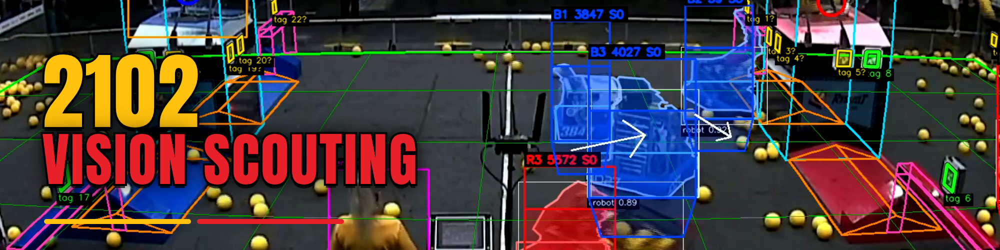

I really enjoy working on our scouting application. It's grown in scope over the past 2 seasons and has basically become a full competition app, not just scouting, and we have no intention of abandoning it... However, if I'm honest, it's hard to motivate team members to input good data, and we just don't have the disciplined culture of teams with armies of well trained and motivated scouters, especially for a game this hard to scout. So what's the alternative?

## [color=#FFC107]Automated Vision Scouting[/color] [color=#D32F2F] - Still In Progress, But Getting Real[/color]

I posted about this earlier in the season, and a lot has changed since then. It now tracks every robot on the field from the event livestream, puts the right team number on it most of the time, and maps where everyone drove, all without a single human scouter. It's still not done, but it's at a point where the numbers are worth sharing.

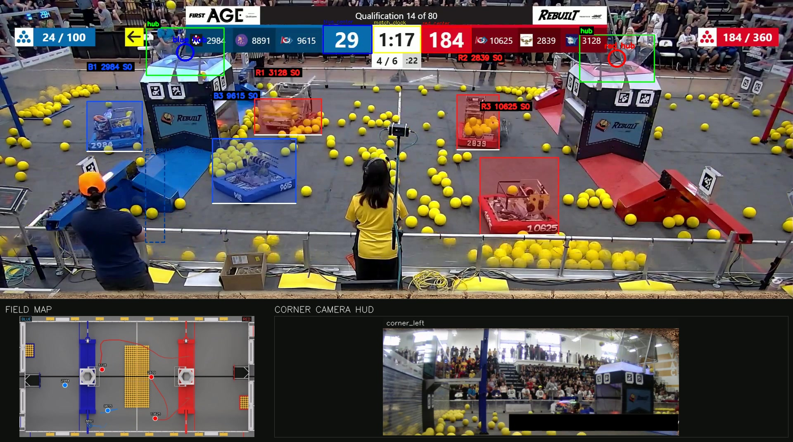

The 20-minute demo reel shows the best, middling and bad tracking from Curie, plus some edge cases:

https://youtu.be/ZpAQoMeAiNk

## [color=#1976d2]The Goal[/color]

Same requirements as before:

* No human scouters identifying robots
* No special equipment at events (use the event stream from TBA/YouTube)
* Works at any event without custom training (no photographing every robot in the pits)
* Reasonably adaptable to future seasons
* Doesn't need to be real time, but has to keep up with the match schedule so the data is ready for match strategy and the picklist meeting
* Develop on my own hardware, rent GPUs at the event

## [color=#D32F2F]How It Works, In One Picture[/color]

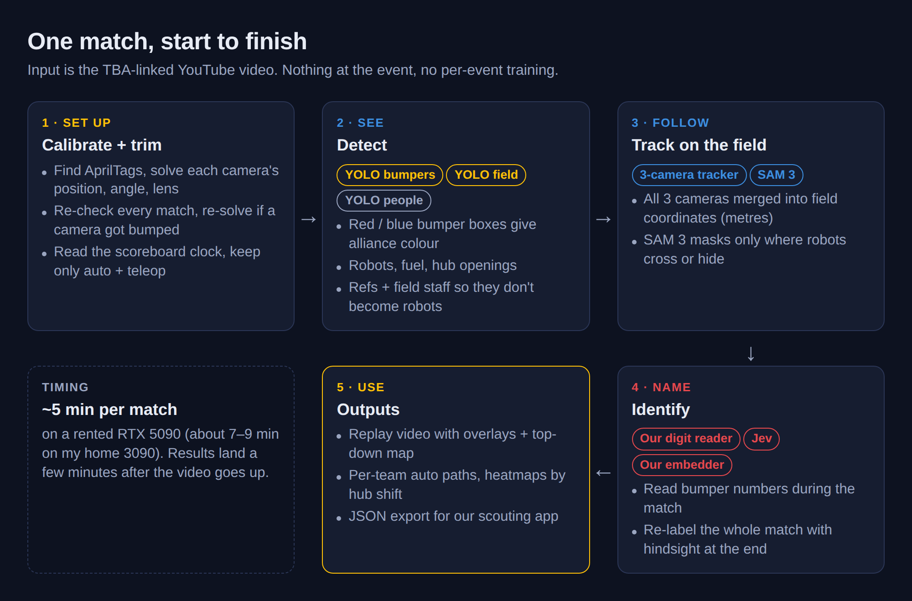

1. **Set up.** Figure out exactly where each broadcast camera is and how its lens bends the image, using the AprilTags on the field. Read the scoreboard clock so I only process auto and teleop.
2. **See.** Object detectors find bumpers (and their alliance color), robots, fuel, and people.
3. **Follow.** All three camera views get projected onto the field in meters and merged into one tracker, so a robot is a point on the field, not a box in a video.
4. **Name.** Read bumper numbers to put a team on each track, then re-label the whole match with hindsight once it's over.
5. **Use.** A replay video, a top-down map, auto paths, heatmaps, and a JSON export that feeds our scouting app.

## [color=#FFC107]Results So Far[/color]

**On 4 hand-tracked matches from 4 different events across 2 seasons, the pipeline tracks 86% of robot time (while a robot is visible to at least one camera) and has the right team number on 75% of it. It has the wrong team number about 1% of the time.** The rest is "tracked, but not confident enough to name yet", which is on purpose (more on that below).

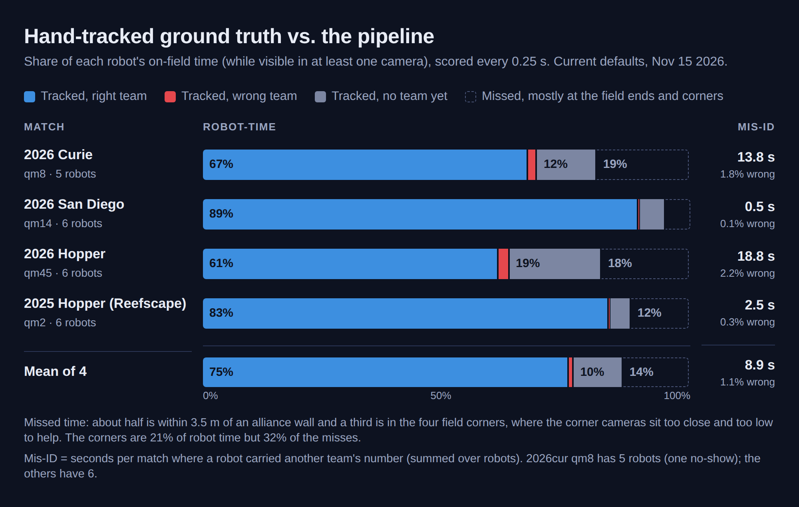

The time it misses is mostly at the ends of the field and in the corners. The corner cameras sit too close and too low to see those spots well, so tracking there leans almost entirely on the main camera.

For context, when I built the first ground truth for Curie qm8 in early November, the pipeline had the right team only 18-30% of the time and the *wrong* team 25-42% of the time. That second number was the real problem, and getting it down to about 2% is where most of the work went.

It also runs on 2025 Reefscape footage without retraining anything game-specific for identity, which is a good sign for next season:

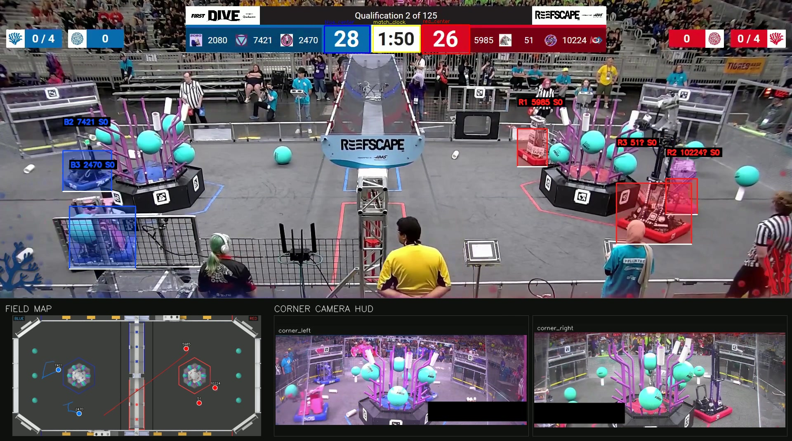

A full match takes about 5 minutes on a rented RTX 5090 (7-9 minutes on my home 3090).

### [color=#D32F2F]A Whole Event: Curie 2026[/color]

Four hand-tracked matches only go so far, so I ran the entire Curie division: all 124 quals plus playoffs and finals, 138 matches, straight from the TBA videos with no manual fixes in between.

* **137 of 138 matches processed** on my home 3090, one at a time, in **16.7 hours** (median 7.5 minutes a match). On two rented 5090s (about 5 minutes a match each) it would be about 6 hours.
* **About $8 of Jev reads for the whole event** (6 cents a match), and nothing else besides electricity.
* **86% of robot time tracked and 79% of the tracked time named**, averaged over the 136 matches that had real match footage. That's in line with the hand-tracked numbers above, which is a good sign the 4 test matches weren't a fluke.
* **About 1% of named time has the wrong team**, estimated by having Jev independently check about 4,400 sampled moments across all 136 matches (the auditor described under Testing below; about $1.60 for the whole event). That matches the 1.1% from the hand-tracked matches. One caveat: the auditor can only judge moments where a bumper is readable from some camera, about a quarter of the sampled time, so it can't see mistakes in the hardest moments.
* **The camera moved twice during the event** (before Q63 and before semifinal 4). Both times the match noticed, re-solved the calibration from its own frames, and carried on. On about 30 matches a corner camera got bumped *during* the match and was dropped for that match, which costs some coverage at the ends of the field but never produced garbage positions.

What broke:

* **Q37** was broadcast entirely from a robot's onboard camera. Calibration correctly refused it (the AprilTags were "57 meters" off), so there's no data for that match.
* **Q32 and Q72** have the wrong video on TBA: crowd shots and the results screen, no match. The pipeline tracked nothing, which is the right answer, but the match is lost.
* **Q76**: the broadcast cut to a side camera about 75 seconds in and never came back, so the second half of the match is untracked.

The spread across matches is the interesting part. The best matches (Q97, Q98, Q122) have about 90% or more of robot time tracked and 84-92% of that named. The weakest matches with real footage (Q7, Q22, Q61) are tracked almost as well (82-84%), but only 62-65% of that time is named. The gap is identity, not tracking, and it tends to sit on one alliance: in Q22 all three red robots are unnamed about 40% of the time, and in Q61 it's two of the blue robots. The lineup matching needs a few clean bumper reads of each robot to work from, and some matches just don't give it any. The [demo reel](https://youtu.be/ZpAQoMeAiNk) shows good, middling, and bad matches back to back so you can judge for yourself.

## [color=#1976d2]The Tech, Piece By Piece[/color]

I don't want to get too far into the weeds, so here's each piece, what it is, and what we use it for.

### [color=#D32F2F]Camera Calibration: AprilTags + Field Geometry[/color]

The cameras are the same at every event but the angles aren't, and they get bumped or re-zoomed mid-event. The app uses the AprilTags and the known field layout to solve each camera's position, angle, and lens distortion. Most tags are too small on the stream to actually decode, so the app looks for tag-shaped squares, has Jev (more on that below) confirm each one really is a tag, and uses the field map to work out which tag it must be. This used to be me clicking on tags by hand; now it runs automatically when I load an event, and I just review the overlay and confirm it (or fix it manually if it's off).

Where the tags are in the frame matters as much as how many there are. These are wide-angle lenses with a lot of fisheye warp, and the warp is strongest at the edges. If every tag used in the solve sits in the middle of the view, the solve can't tell how warped the edges are, the overlay looks fine in the middle, and robots near the edges of the frame land in the wrong spot on the field. So the solve needs tags from the middle *and* the far edges of each camera's view.

Every match also gets checked against the calibration. If a camera moved between matches, it re-solves from that match and adopts the new calibration automatically when the fit is good. If a camera moves *during* a match, that camera is dropped for that match rather than producing garbage positions. Event broadcasts don't all use the same layout either (especially offseasons), so it also detects where the main and corner camera panels are in the stream. Hawaii and Utah are a good example of how different two regionals can look: Hawaii has a low, wide main camera with the scoreboard and corner cameras stacked in the middle of the screen, and Utah has a high, steep main camera with the corners along the bottom. Both calibrated from the same automatic process. It's not perfect; one of Hawaii's corner cameras didn't pass the automatic check and still needs a manual fix.

Knowing the field geometry lets me ignore anything outside the field (robots in queue, weird things in the stands), and draw zones on field structures where the tracker isn't allowed to *start* a new robot, which killed a whole category of "the FMS radio on a pole is a robot now" false positives.

### [color=#FFC107]Detection: YOLO[/color]

**YOLO** ("You Only Look Once") is a fast object detector. We trained our own:

* **Bumper model:** boxes red and blue bumpers, which also gives us the alliance color. It was trained with hard negatives for things that kept getting detected as robots: scoring tablets, FMS radios, and other field equipment.
* **Field model:** robots, fuel, and hub openings.
* A stock YOLO model for **people**, so refs and field staff standing in front of the field don't become robots.

On top of that there's a stack of sanity checks I added one painful false positive at a time: reject boxes that overlap a person, boxes that are implausibly wide for their distance from the camera, and so on. I tried bumper color with plain HSV thresholds early on, and it was way too finicky (dark blue bumpers, red-painted robots on the blue alliance). The trained bumper model is much better.

### [color=#1976d2]Tracking: Multi-Camera Field Tracker + SAM 3[/color]

YOLO only sees one frame at a time. The tracker turns those detections into six robots moving around the field over time, merging the main camera and both corner cameras in field coordinates. When a robot goes somewhere no camera can see (behind the hub, under the event banner on the corner cams), the tracker coasts it along instead of inventing a new robot when it pops back out.

**SAM 3** (Meta's Segment Anything 3) is a video segmentation model: give it a box and it masks out the whole robot and follows it frame to frame. It's great at overlapping and partly hidden robots, but it's slow. So it only runs where it's needed: when robots get close, cross, or disappear behind something, SAM 3 runs on that window to keep identities from swapping. The rest of the match is tracked from YOLO boxes alone.

This one surprised me. I originally ran SAM 3 on every robot, every frame, and assumed more was better. On the ground truth matches, full SAM 3 was slower *and* worse. Running at higher frame rates (10, 15, 30 fps) was also steadily worse. The "use it only where it helps" version wins on both speed and quality.

### [color=#D32F2F]Identity: Reading Bumper Numbers[/color]

This is still the hard part, and where most of the work has gone. I keep re-learning that the bumper number is the only thing that actually tells two robots on the same alliance apart. From a wide camera, robots with red bumpers look a lot alike, especially in a game where everyone is a box. Everything else can support the number, but never replace it.

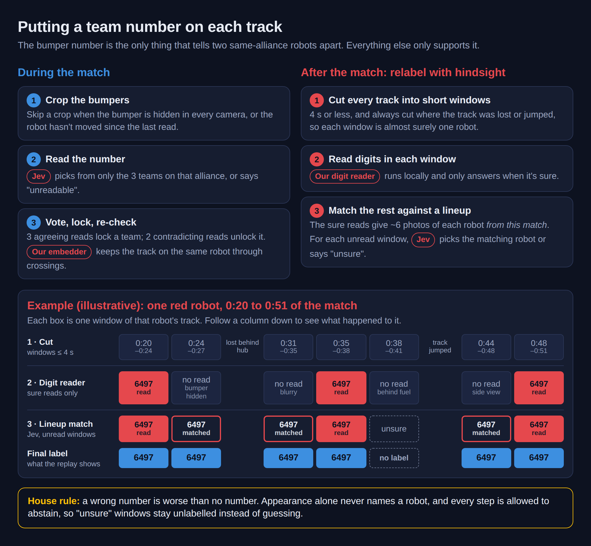

There are three models involved:

* **Jev** (a hosted "decision model" from TypeSafe). You give it an image and a multiple-choice question, like "which of these 3 teams is this, or is it unreadable?", and it returns a probability for each answer. It's fast (about 0.2 s) and very cheap (a few cents per match), and it never invents a team that isn't one of the options. It does the reads during the match and the lineup matching at the end.
* **Our own digit reader**, a small text-recognition model (PARSeq) we fine-tuned on about 54,000 bumper crops from 15 events across 2024-2026, covering 537 different teams. On events it never trained on, it gets about 92% of readable bumpers right and is wrong on fewer than 0.5%; the rest it declines to answer. It runs locally in a fraction of a millisecond.
* **Our own robot embedder** (DINOv3, fine-tuned). It turns a robot crop into a "fingerprint" so the tracker can tell whether the robot it sees now is the one it was following a second ago. It was trained on pairs of crops of the same robot from different matches. It keeps tracks from jumping between robots; it's never allowed to name a robot on its own.

Before any of those see a bumper, there's one more problem: a lot of event streams are **interlaced**. Each frame is really two half-frames captured 1/60 of a second apart, woven together line by line. Anything that's still looks fine, but anything moving (like a robot) gets "combed" into horizontal stripes, and comb lines through a bumper number make it unreadable. Not every event does this, but when it does, the app splits the two half-frames back apart, lines them up, and merges them before reading. Turning that on for the hindsight relabel added about 4-5 points of right-team time on Curie with no increase in wrong labels.

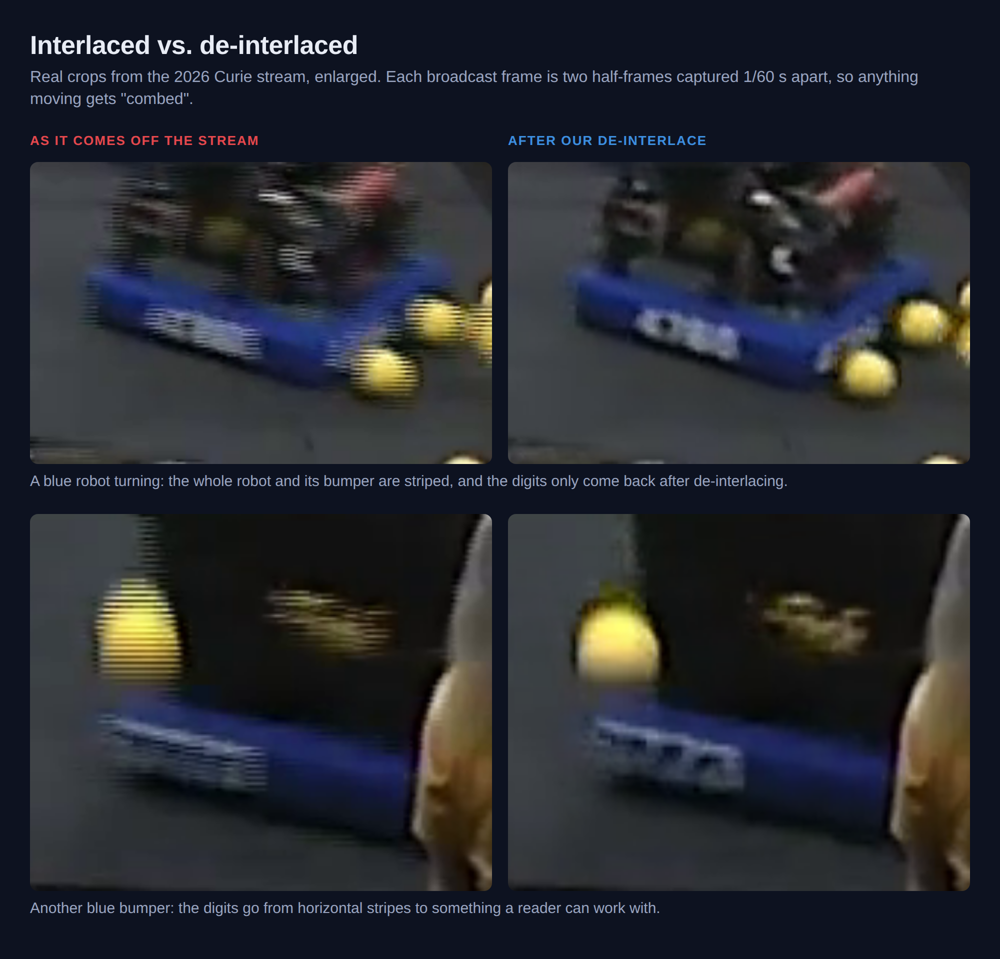

During the match, crops get read, votes are cast, and a team "locks" after 3 agreeing reads. The lock is never permanent; 2 contradicting reads flip it, because I learned the hard way that a confidently *wrong* lock is much worse than an unconfident one. Reads are skipped when the bumper is hidden in every camera or the robot hasn't moved, since reading is one of the more expensive steps.

After the match, the **hindsight relabel** throws out the live labels and starts over with everything it now knows. Every track is cut into short windows (4 seconds or less, split at any gap or jump, so each window is almost certainly one robot). Our digit reader reads each window. The windows it's sure about become a "lineup card" with a handful of photos of each robot *from this match*, and Jev matches the remaining windows against that lineup. Anything that's still unsure stays unlabelled. That one stage cut mis-identified time on qm8 from 40-68 seconds per match to 12-20 seconds when it first went in, and it's the reason a robot that wasn't identified until 30 seconds in still gets credit for its auto.

### [color=#FFC107]Training Our Own Models: Teacher and Students[/color]

The digit reader and embedder didn't exist a month ago. The approach was "teacher and students":

1. Download the qual videos from 15 events across 3 seasons, run our detectors over them, and save every bumper and robot crop (about 455,000 crops from 218 matches).
2. Have Jev read the bumpers in bulk, constrained to the TBA roster for that match (about $8 for all of it).
3. Have Claude judge several hundred crops as a "gold" test set, to check how often the bulk labels are wrong and to score the trained models fairly.
4. Train small, fast models on the bulk labels and test them only on events they never saw.

### [color=#1976d2]The Output: Scouting Data[/color]

Once robots have positions and team numbers, the scouting part is the easy part. With a whole event processed, the scouting page has enough data to be genuinely useful. For each team it shows auto paths across all their matches, grouped into repeated routines (red-alliance matches are rotated onto the same side so a routine run from either alliance groups together), and heatmaps of where they spend time during each hub shift. It all exports as JSON into our scouting app.

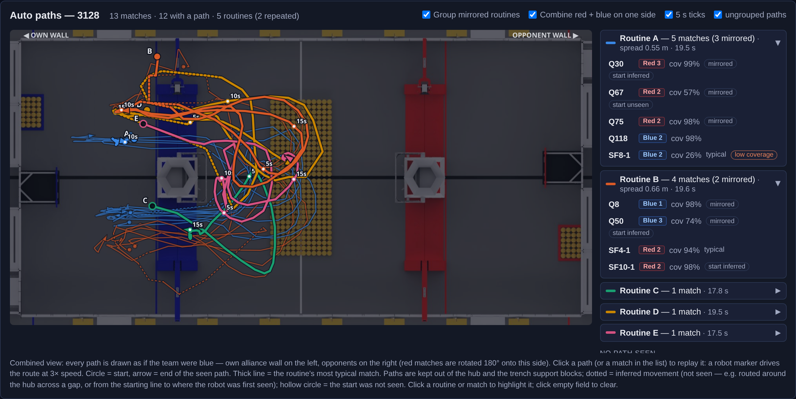

The heatmaps are summarised by the three zones that matter in this game: your own alliance zone, the neutral zone, and the opponent's alliance zone. 3128 splits its hub-active time between its own zone and the neutral zone, and when its hub is inactive it lives in the neutral zone (88% of that time), almost never crossing to the opponent's side.

The rows below "All stations" split the same maps by which driver station the team started from, since teams often run a different plan from each one. 3128 is fairly consistent, with one difference: from station 1 it spends 69% of hub-active time at home, versus 48% from stations 2 and 3.

A defense robot looks completely different. 2682, Curie's dedicated defender, spends 68% of its hub-active time and 80% of its hub-inactive time in the opponent's alliance zone, and it does that from every driver station. Where in that zone changes with the station, though: from station 2 it works the upper part of the opponent's zone, from station 3 the lower part, and from station 1 most of it. That's the part of the field its drivers can see best from where they're standing.

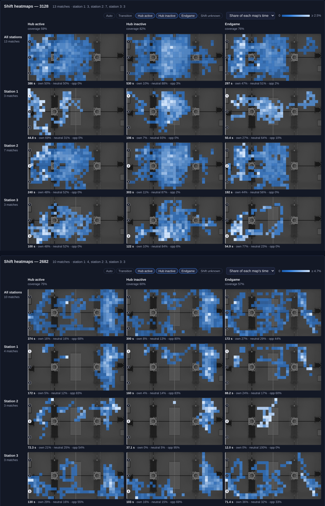

## [color=#FFC107]What Location Alone Can Tell You[/color]

Without counting a single game piece, knowing where every robot is several times a second tells you a lot. When I first drafted this post, this section was a wish list. With a full event of data, the first four are now event-wide rankings on the scouting page:

* **Movement.** Average speed while tracked, and how much of the match a robot spends moving. A robot that's always going somewhere is usually cycling; one that parks for long stretches is waiting on something (loading, aiming, or being stuck).
* **Cycles.** Every trip between the neutral zone (where the fuel is) and the robot's own alliance zone counts as a cycle, ranked as cycles per teleop minute.
* **Defense.** Share of teleop spent in or next to the opponent's alliance zone.
* **Stuck on the bump.** Seconds per match spent stopped on top of a bump. Do it once and it's bad luck; do it every match and it's worth knowing before you pick them.

Rankings are on rates, not totals, because coverage varies (some robots are tracked 80% of the match, some 50%).

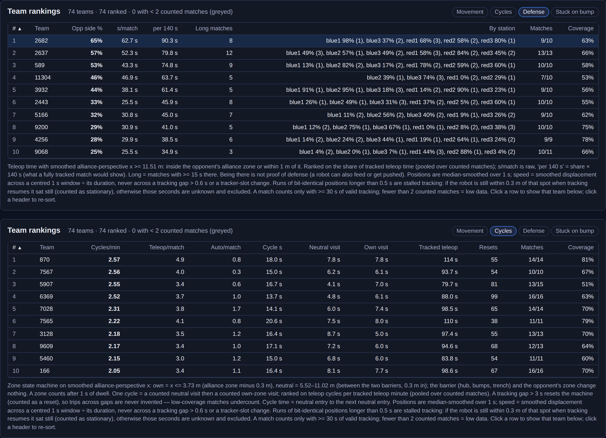

### [color=#1976d2]Checking the Rankings Against Human Scouts[/color]

A ranking is only useful if it agrees with what actually happened on the field. 3128 scouted Curie with their Manta app, so I compared every ranking against their human-scouted data (702 team-matches that both of us covered, all 74 teams), and against [Match13](https://www.match13.com)'s team ratings (its xP rating after each team's last Curie qualification match). Each number below is a Spearman rank correlation: 1.0 means both sources put the teams in exactly the same order, 0 means no relationship.

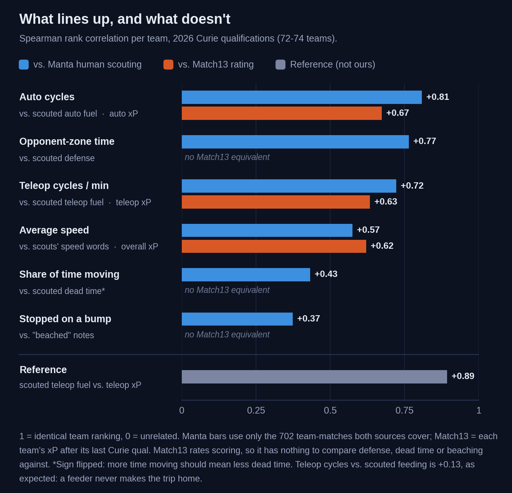

**How to read these numbers.** 1.0 would mean perfect agreement, and 0 means none at all, but 1.0 isn't a realistic target: the scouts miss things too, and Match13 is a model. The grey bar at the bottom is two good sources measuring the same thing (Manta's counted fuel against Match13's teleop rating), and even they only reach 0.89. Treat that as the ceiling. In practice:

* **Around 0.8** (auto cycles, defense): pick two teams that are clearly apart and we put them in the same order as the scouts about 90% of the time.
* **Around 0.5-0.6** (speed): that drops to about 75-80%, and for two teams that are close together it's not much better than a coin flip.
* **Almost never backwards**: across all of these, our top quarter of teams almost never lands in the scouts' bottom quarter (at most 1 of 18 teams, 2 for the bump metric).

So it's good for sorting teams into tiers (top third, middle, bottom third), not for deciding whether a team is 12th or 15th.

Match13 rates points scored, and trips or speed are only part of how a robot scores, so those numbers run a bit lower (0.62-0.67). Match13 doesn't rate defense, dead time or getting beached, so those rows only have the scouts to check against.

In each chart below, the left panel is against Manta's scouts and the right panel is against Match13.

**Auto cycles line up best.** The teams that make the most trips out to the neutral zone and back during auto are the ones scoring the most in auto. Our top two, 1987 and 7028, average 1.7-1.8 auto cycles a match, and both are in the top 8 of the scouts' auto fuel counts (52-54 fuel a match) and of Match13's auto rating. 9 of our top 10 are in the top quarter of both.

**Teleop cycles count trips, not fuel.** That's mostly the same thing, but not for everyone. 254 and 125 are two of the top three fuel scorers and only mid-pack on cycles, because they shoot from anywhere and rarely need to drive home. 7567 is the opposite: lots of trips, little fuel (scouts note intake trouble). Cycles also don't line up with scouted *feeding* (0.13), which makes sense: a feeder pushes fuel to a partner and never makes the return trip.

**Speed is a looser match.** Scouts rate how fast the drivetrain is; we measure how much the robot actually drives, stops included. 6615 gets called "fast" by the scouts but is parked shooting half the time. Against Match13, the outliers are defenders like 4786, which drive a lot without scoring much.

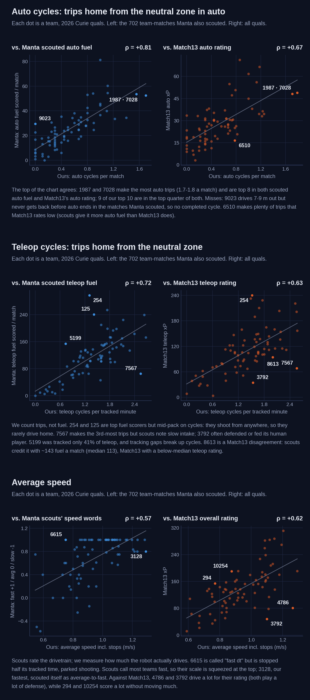

**Defense lines up well with the scouts, and the misses are informative.** 2682 is the clear #1 for both. The biggest miss is 4786: scouts log 48 seconds of defense a match, but it's rarely in the opponent's zone. The scouts' notes explain it: "bump/trench defending", "opportunistic defense in nz". Defense played in the neutral zone or at the bumps is invisible to a metric that only counts time in the opponent's zone. In the other direction, 294 and 5907 go into the opponent's zone to steal fuel, which looks exactly like defense to a position-only metric. Against Match13's overall rating it runs the other way (-0.51): the robots spending the most time on the opponent's side are mostly the lower-scoring ones. That's what you'd expect, since alliances usually send their lowest-scoring robot to play defense.

**Getting stuck on the bump is the weakest.** 4027, 5712 and 589 are near the top of both lists, but a lot of the "beached" notes land in a tracking gap: the robot drops out of tracking right on or next to the bump, so that time never gets counted. Scouts also miss some: 9200 sat on a bump for 14 seconds in Q86 and got logged as "out of commission", not beached. Match13 has nothing to compare this against, so this one is scouts only.

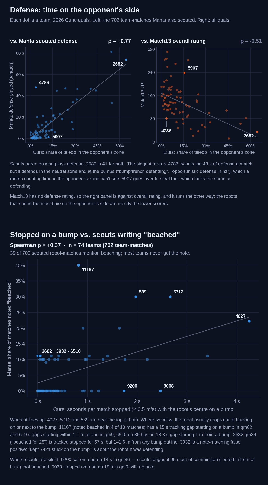

### [color=#FFC107]So What Is It Good For?[/color]

Right now, without tracking scoring directly, it can sort teams into tiers. It's never as good as the best human scouting I have access to (3128's). On scoring, ratings computed from match results also beat it: Match13 lines up with the scouts' fuel counts better than our trip counts do (0.89 against 0.72 in teleop, 0.84 against 0.81 in auto). That's not surprising, since those ratings are built from points and we don't count fuel at all.

Where it earns its place is everything a results-based rating can't see. Match13 can't tell you who played defense, where a robot drives, what its auto does, or whether it keeps getting stuck on the bump, and those are exactly the things this measures. Defense agrees with the scouts at 0.77, from position alone.

So what I'd use it for today is supplementing our human scouters and taking some of the load off them: auto paths for sure, number of cycles, and time spent playing defense. Our scouters can then focus on what the video can't see yet, like how much a robot actually scores and why it struggled.

How useful it is will depend on next year's game. This year's autos were all pretty similar, but in 2025 some were complex enough that alliance partners had to check their paths were compatible, and having every team's autos mapped automatically would have been a big help there.

Other location-only metrics that are next on the list:

* **Where a team plays from each driver station.** The heatmaps are already split by station, so you can see whether a team changes its plan based on where it starts.
* **(2025) Slow to load or slow to score.** In Reefscape, a long stop at the coral station means slow intake, and a long stop at the reef means slow scoring. You don't need to see the coral to know a robot is spending 8 seconds at the station when its partners spend 3.
* **(2025) Best and worst reef faces.** Time spent at each of the six reef faces, per visit, would show which faces a team scores on fastest.

These carry over from game to game better than anything that depends on counting a specific game piece. "Stopped too long at the loading station" means the same thing in any year.

## [color=#D32F2F]Testing: Ground Truth, and Checking Against Claude[/color]

For most of the season I was judging changes by watching replays and squinting. That doesn't scale, and it's misleading, because a change that fixes the match you're staring at can quietly break three others. So I built real ground truth.

**Hand tracking.** I built an annotator where I pick a robot, play the match at quarter speed, and hold the mouse on that robot as it drives. Let go to pause and pick it up on a corner camera; hold Shift when it's hidden to mark the position as a guess. One robot is a few minutes of work, so a full match is a sitting. So far I've done 4 matches (23 robots) from 4 events across 2 seasons, picked to cover different camera setups and venues.

**Scoring.** A script compares every pipeline run to the hand tracks every quarter second: was each robot tracked (within 1 meter), did it have the right team, the wrong team, or no team, how many seconds was it mis-identified, and how far off was its position. That's where the chart above comes from.

**Deciding.** Two identical runs of the same match don't give identical results (labels swing about ±5 points between runs), so every change runs twice on all 4 matches, and it only becomes the default if it beats that noise and no match gets worse. A lot of ideas that looked great on the one match I'd been staring at died here, including the "more SAM 3, more frames" ones above.

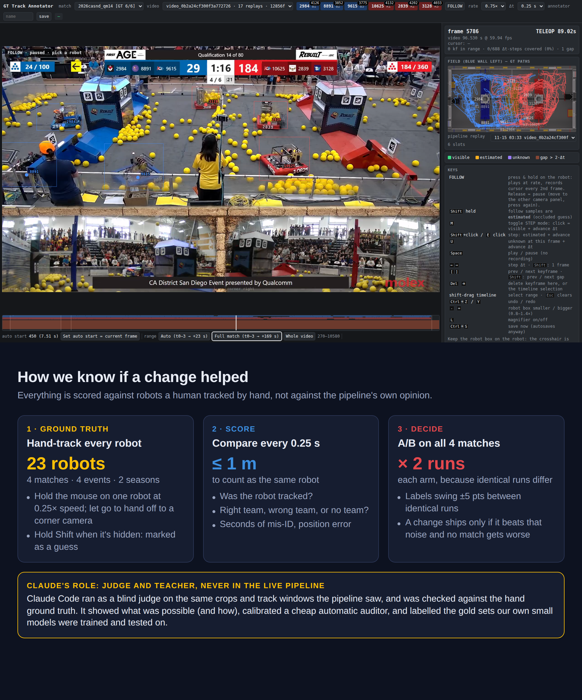

**Checking against Claude.** I also used Claude (through Claude Code) as an independent judge. It looked at the same crops and track windows the pipeline saw, blind, and either named the robot or abstained, and I checked its answers against my hand ground truth. A few things came out of that:

* **It showed what was possible, and how.** On qm8, Claude judging short track windows against a lineup of the match's own robots got the right team 60% of the time with 1% wrong, when the pipeline at the time was at 37% right / 9% wrong. That experiment is where the hindsight relabel came from; I then rebuilt the same method with Jev and our own digit reader, and it's now down to about 4 cents a match.
* **It calibrated a cheap auditor.** On matches without hand ground truth, Jev audits a sample of labelled frames. Claude agreed with my hand tracks on 54 of 54 checked items, and Claude and Jev agreed on 48 of 49 on another match, so I trust the cheap auditor for spot checks.
* **It made the gold test sets** for the teacher/student models above.

Claude isn't part of the live pipeline, though. It was too expensive per match (over a million tokens for one match in that first experiment), and I want the production version to run on local models plus cheap reads.

## [color=#FFC107]Caveats[/color]

* **Ground truth is still small.** 4 matches is enough to catch regressions, not enough to promise how it'll do at your event. More hand-tracked matches at different venues is the next step.
* **Some matches are just harder.** The Hopper 2026 match is at 61% right team versus 89% at San Diego. Camera height and angle matter a lot: a high, steep camera gives better positions but makes bumpers nearly impossible to read.
* **Some bumpers are unreadable.** About a fifth of bumper fonts are too thin or too tightly spaced to read at broadcast resolution (including my own team's), and bumpers sit low enough that everything, fuel included, hides them. Those robots lean on the lineup matching, which works but needs at least a few clean reads per match.
* **Corner cameras are only partly useful.** The event name banner across the bottom eats a big chunk of their view.
* **Run-to-run noise is real.** The same match processed twice can differ by a few points. Fine for scouting trends, not for counting exact seconds.
* **No per-robot scoring.** With the season over, I'm not going to build fuel attribution for this game. The field model does detect fuel, and the UI has some scoring bits in it, but my focus is detection, location, and identity, because those carry over to every game. Once the 2027 game comes out, I'll work out what scoring should look like for it.

## [color=#1976d2]Running It Live: A Small Swarm on vast.ai[/color]

My original plan was to rent one big GPU (an H100 at about $2.50/hr) for the event. Profiling killed that idea: one match uses about 3-4 CPU cores and the GPU sits around 25% busy, so a bigger GPU barely helps. A $2.69/hr RTX PRO 6000 ran a match in about 6 minutes; a $0.77/hr RTX 5090 on vast.ai, with a fast desktop CPU, did it in about 5. What does scale is running one match per server on several cheap servers at once.

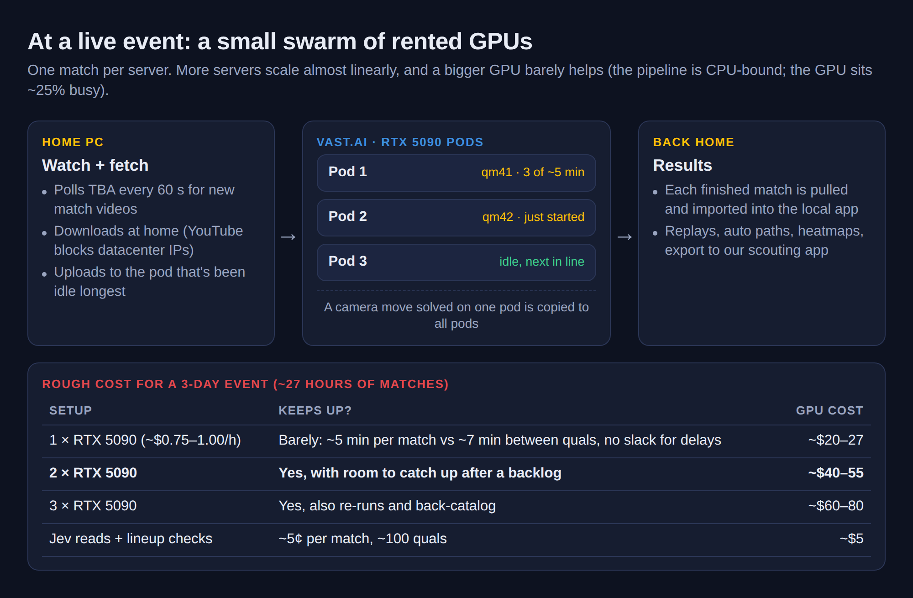

The live mode is built:

* My home PC polls TBA for new match videos every minute and downloads each one (YouTube blocks datacenter IPs, so the download has to happen at home).
* Each new match gets uploaded to whichever rented server has been idle longest.
* If one server finds that a camera moved and re-calibrates, that calibration gets copied to all the other servers, since each one only sees every 2nd or 3rd match.
* As each match finishes, its results are pulled back and imported into the local app automatically.

At about 5 minutes per match and quals about every 7 minutes, one 5090 could almost keep up on its own, but there's no slack for delays or a backlog after lunch. **Two 5090s at $0.75-1.00/hr each is the sweet spot: roughly $40-55 in GPU time for a 3-day event**, plus about $8 of Jev reads (what the Curie run actually cost). A third server (about $60-80 total) adds room for re-runs and processing earlier matches. The same setup can catch up on a day's backlog of matches in an hour or two.

The full Curie run above went through this same dispatcher, just pointed at my own PC instead of rented servers, and it ran unattended overnight start to finish (one match failed on purpose, Q37). I've also run individual matches on rented RTX PRO 6000 and RTX 5090 servers. What I haven't done yet is run it live while an event is happening.

## [color=#D32F2F]What's Next[/color]

The season's over, so the goal now is getting this ready for 2027. Three things are at the top of the list.

### [color=#FFC107]Counting Scoring[/color]

This is the big missing piece. Everything above comes from where robots are, not what they score. How hard it is to add scoring depends a lot on the game:

* **Pick and place** (like 2025's coral on the reef) is the friendlier case. A game piece shows up at a scoring location right where a robot is parked, so whoever is at that spot when it appears almost certainly scored it. The position tracking already does most of the work.
* **Shooting** (like this year's fuel) is much harder. Pieces fly across the field, several robots can be shooting at the same goal at once, and the goal is often across the field from the shooter. Crediting a shot means following the piece back to the robot that launched it, or at least knowing which robots were shooting when the count went up.

I'll know which kind of problem it is when the 2027 game is revealed, and the plan is to build whichever one it needs early in the season instead of after it.

### [color=#1976d2]More of Our Own Models[/color]

The robot embedder and digit reader above came out of the teacher/student setup: bulk labels from a cheap model, a gold set judged by Claude, and small fast models trained on top. That worked well enough that I want to use it for more specific features: things like whether a robot is holding a game piece, whether an intake or climber is deployed, or which mechanism it's using right now. Each one is a small model that's cheap to run on every robot crop, and each one turns "where was it" into "what was it doing there".

### [color=#D32F2F]Robot Archetypes[/color]

Scouts already sort robots into types without thinking about it: trenchbot or tallboi, dumper or turret. Those types matter for strategy (who can take the trench route, who has to line up to shoot), and they're mostly visible from the stream. Some of it even falls out of position data for free: a robot that's tracked driving under the trench arm has to be short enough to fit. The rest is a good fit for the same embedding approach: label a few dozen robots by type, then let the model sort the rest of the event.

### [color=#FFC107]Also on the List[/color]

* Running it live at an event, with the data ready for the picklist meeting
* More hand-tracked ground truth from more venues
* Video-checking the rankings' outliers (the bump metric especially) and tightening the ones that don't hold up
* Retraining the detectors on the 2027 robots and field
* Possibly reading the robot signal light: it blinks when a robot is enabled, and I can sometimes spot it on the stream, which would mark exactly when auto and teleop start for each robot

What do you think? Any suggestions or criticisms? How are you trying to tackle this problem?
